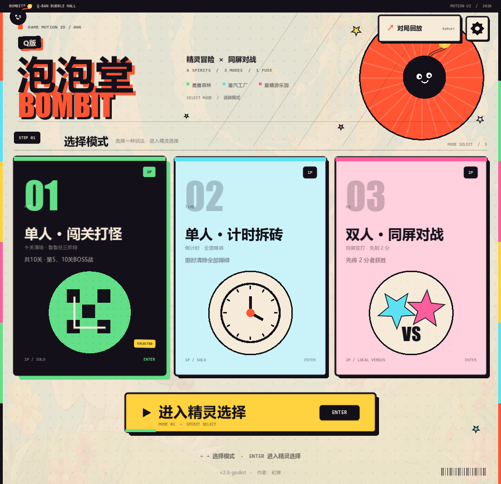
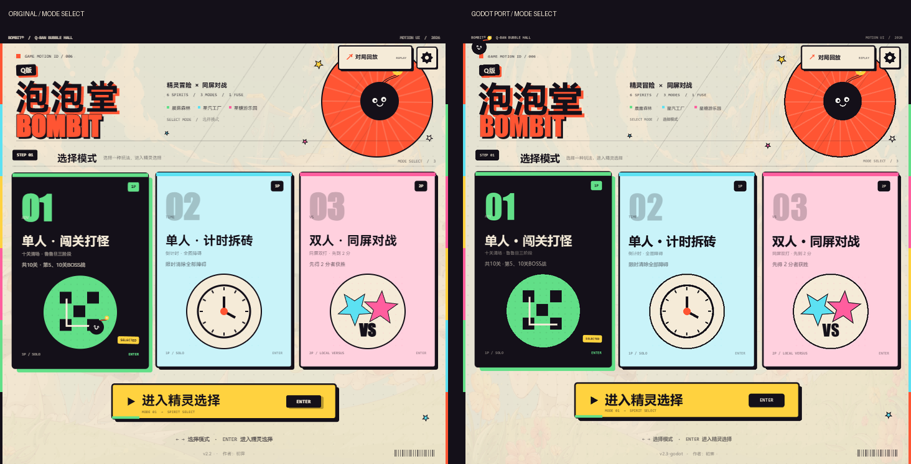
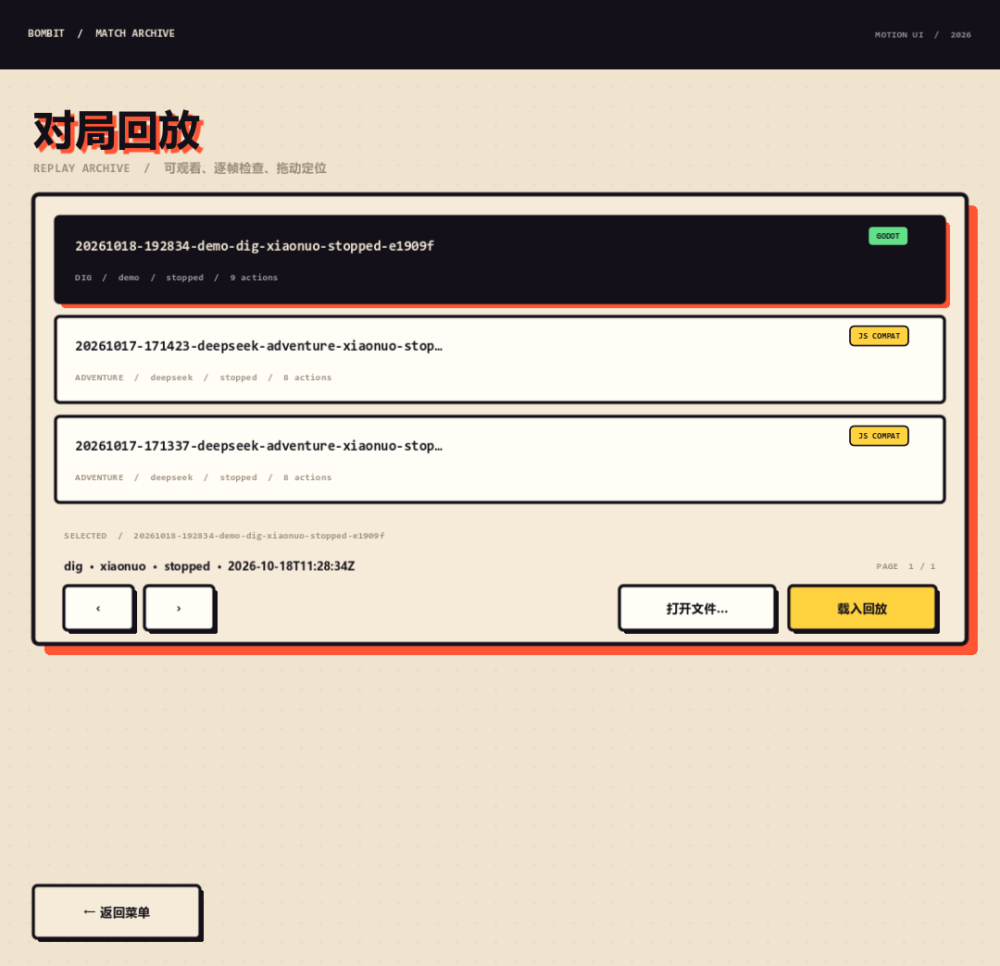
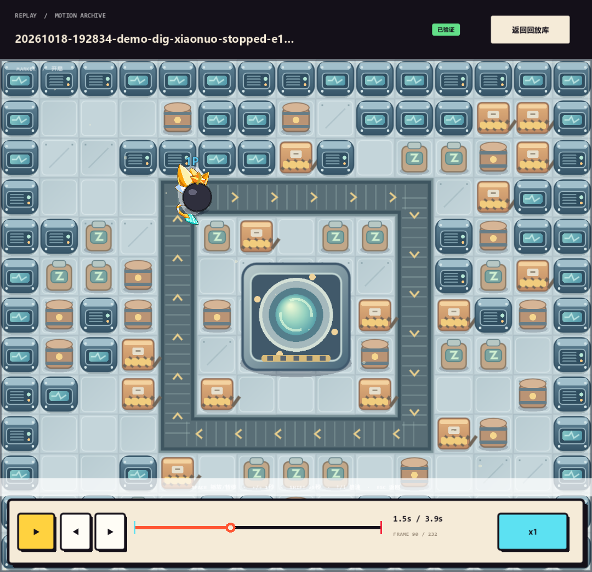

# Q版泡泡堂 · BombIt（Godot 移植版）

> 把 `E:\BombIt` 的 HTML5 Canvas 原生 JavaScript 游戏 **BombIt v2.3** 完整移植为 **Godot 4.7** 工程。
> 三种模式、六位精灵、十关冒险、三主题随机场景、道具、小怪与鲁鲁旦 BOSS 战、菜单 / 关前档案 / HUD / 暂停 / 结算、配乐与音效，全部在 Godot 中重新实现，不依赖浏览器或 Web 技术。

- 版本：`v1.0-godot`（对照原作 `v2.3`）
- 引擎：Godot **4.7.2-stable**，GL Compatibility 渲染器
- 语言：GDScript（约 5 千行），素材沿用原作的 PNG / MP3，并程序化合成 19 个音效
- 成品：
  - Windows：`build/windows/BombitGodot.exe`（同目录需要 `BombitGodot.pck`）
  - Web：`build/web/index.html`（需要用 HTTP 服务器打开，不能双击 `file://`）
  - 绿色包：`dist/BombIt-Godot-v1.0-win64/` 与同名 zip

---

## 界面预览



**原作（左）与 Godot 移植版（右）对照：**



| 精灵选择（动效海报） | 关前敌情档案 |
|---|---|
|  |  |

| 森林关卡（绿色包实机） | 工厂 BOSS |
|---|---|
|  |  |

| 工厂传送带 | 星糖游乐园 |
|---|---|
|  |  |

| 暂停 | 结算 |
|---|---|
|  |  |

| 回放库 | 回放播放器 |
|---|---|
|  |  |

---

## 通灵柔光 / Soul Bloom

未来觉醒后的柔光与 1.6 秒通灵爆发。**没有任何 blur 图元、后处理、SubViewport 或全屏拷贝**：
柔光形状来自立绘 alpha 烘出的有符号距离场（SDF），颜色、边缘、呼吸、色散全部是解析函数；
大范围环境光用预生成的径向渐变纹理，法环 / 灵星 / 半调点用矢量绘制。

| 通灵状态 | 通灵觉醒 |
|---|---|
|  |  |

- 柔光沿透明立绘的真实轮廓走：SDF 主光每像素 3 次采样（主轮廓 + 左右色散），墨晕层 1 次；没有高斯核。
- 觉醒时闪白 / 光柱 / 软环在角色**背后**，星屑 / 集中线 / 半调点在**前面**，人物始终留在最上层。
- 实机参数为浅色地图做了克制：`energy=0.34`、墨晕 `0.60`、体积光 `0.35`；展示台用更亮的 `1.0 / 0.27 / 1.0`。
- SDF 已离线烘成 `assets/characters/*.sdf.png`（正面 / 背面各一张），运行时显示 `BAKED / 0 ms`；
  若换新立绘没有对应资产，`SoulSdf` 会自动回退到运行时 chamfer。
- 预览：双击 `启动通灵预览.bat`，或在编辑器打开 `soul_preview.tscn` 按 F6；
  `SPACE` 通灵、`A` 光环、`S` 慢放、`R` 重置、`Esc` 退出。

---

## 一、怎么玩

### Windows

双击 `build/windows/BombitGodot.exe`，或双击根目录的 `启动游戏.bat`。

> 第一次运行若被 SmartScreen 拦截，选择「更多信息 → 仍要运行」。这是未签名的自制程序，属正常现象。

### Web

双击根目录的 `启动网页版.bat`（会启动本地 HTTP 服务并打开浏览器），
或者自己起一个静态服务器：

```powershell
python -m http.server 8077 --directory build/web
# 浏览器打开 http://127.0.0.1:8077/
```

### 操作键位

| 模式 | 玩家 | 移动 | 放炸弹 | 技能 |
|---|---|---|---|---|
| 单人（闯关 / 拆砖） | 1P | `↑↓←→` 或 `WASD` | `空格` | `Q` |
| 双人（同屏对战） | 1P | `↑↓←→` | `Enter` | 右 `Shift` |
| 双人（同屏对战） | 2P | `WASD` | `空格` | `F` |

其他：`Esc` / `P` 暂停，`R` 重开本局，`M` 静音（暂停时按 `M` 是返回菜单），`Tab` 切换 1P 备用键位（`IJKL` / `U` / `O`），`F11` 全屏。
菜单和结算界面都可以直接用鼠标点，`Enter` 开始 / 再来一局。

### CLI / MCP / 回放

- 人类 CLI：双击 `启动CLI.bat`（`w/a/s/d`、`b`、`q`、`wait`、`look`、`new`、`quit`）。
- Agent CLI：`build/windows/BombitGodot.console.exe --headless --no-header -- --cli ...`。
- MCP：把 [`mcp/bombit-mcp.json`](mcp/bombit-mcp.json) 复制到客户端配置，或运行 `bombit-mcp.bat`。
- 游戏内：菜单右上角「对局回放」打开回放库，支持播放/暂停、倍速、逐帧、拖动定位；Godot 回放会校验哈希，原作回放以兼容模式播放。
- 通灵柔光预览：双击 `启动通灵预览.bat`，或编辑器打开 `soul_preview.tscn` 按 F6；`SPACE` 通灵、`A` 光环、`S` 慢放、`R` 重置。

完整命令、工具表和目录说明见 [`docs/Godot-CLI与MCP.md`](docs/Godot-CLI与MCP.md)。

---

## 二、内容清单

| 系统 | 实现情况 |
|---|---|
| **闯关打怪** | 10 关；第 1 关谷谷歌歌，第 2 关加克劳德德，第 3 关加偶喷诶艾；第 5、10 关鲁鲁旦 BOSS 战；清场进下一关，第 10 关通关 |
| **计时拆砖** | 180 秒炸光全部软砖；倒计时、剩余软砖数、时间到判负 |
| **同屏对战** | 两人一键盘，先得 2 分；同帧双死各得 1 分；90 秒后死亡加速清空软砖，45 秒后平局 |
| **六位精灵** | 小诺 / 阿修 / 阿瑞 / 小炎 / 小天 / 未来，各自的主动技能或放弹被动完整实现 |
| **道具** | 火力 +1、炸弹 +1、速度 +10%、生命果实、无敌星星、护盾、推弹手套；火焰会烧掉地上道具 |
| **敌人 AI** | 索敌、寻路、炸开挡路软砖、争抢道具、投弹前 0.7 秒前摇并先验证完整撤离路线；拾取星星后获得碰撞伤害 |
| **鲁鲁旦 BOSS** | 8 点生命；试探 / 认真 / 暴走三阶段；毒刺 6 个落点、1.5 秒预警、0.8 秒生效；暴走炸弹可炸掉场内硬墙；暴走专用立绘 |
| **三主题场景** | 晨露森林（古树落果）、星汽工厂（24 格顺时针传送带，运送角色与炸弹）、星糖游乐园（16 格木马环道，绕一圈得护盾） |
| **规则细节** | 刚放的炸弹可以踩出去、连锁引爆、推弹手套、护盾/无敌、重生保护、受击保护、同帧结算、种子化地图 |
| **界面** | 开始菜单（模式 + 六角色选择）、关前敌情档案、战斗 HUD、BOSS 血条、技能冷却、暂停菜单、结算界面、居中横幅提示 |
| **音频** | 菜单 / 两首关卡 / 两首 BOSS 配乐（原 MP3），19 个程序化合成音效，静音开关 |

---

## 三、工程结构

```text
BombitGodot/
├── main.tscn                 主场景：Board / Actors / UILayer(Hud,Menu,Overlay)
├── soul_preview.tscn         通灵柔光 MOTION ID 预览台（深色舞台 + SDF 技术注脚）
├── project.godot             720×696 逻辑分辨率、60Hz 物理步长
├── scripts/
│   ├── Cfg.gd                数值与内容配置（对应 src/core/config.js）
│   ├── Rng.gd                可复现随机数
│   ├── Grid.gd               网格、碰撞、炸弹几何
│   ├── LevelGen.gd           地图生成、连通性校验、三主题设施与环路
│   ├── World.gd / Actor.gd / Bomb.gd / MatchState.gd
│   ├── Rules.gd              放弹、爆炸、连锁、道具、伤害
│   ├── Danger.gd             威胁时间线（AI 逃生用）
│   ├── EnemyAI.gd            小怪与 BOSS 行为
│   ├── Entities.gd           敌人创建、出生点、BOSS 阶段
│   ├── Skills.gd             六位精灵技能与未来通灵
│   ├── Scenery.gd            古树落果、传送带、木马环道
│   ├── Match.gd / GameEngine.gd   赛制与固定 60Hz 逻辑
│   ├── UIDraw.gd              Motion UI 绘制层：奶油纸/墨线/硬阴影/网点/贴纸
│   ├── CanvasArt.gd           Canvas 等价渐变/自适应曲线/旋转椭圆
│   ├── ItemIcons.gd           七种道具图标（32×32 坐标逐项重绘）
│   ├── MapArt.gd              地板/硬墙/软砖变体/设施/传送带/炸弹/火焰/道具/毒刺
│   ├── MapPainter.gd          静态地图图层（SubViewport 缓存）
│   ├── Board.gd               战场动态层与静态地图缓存
│   ├── BombView.gd            炸弹深度节点（与角色按 y 排序）
│   ├── EntityView.gd          角色立绘、朝向、弹跳、护盾、死亡
│   ├── SoulSdf.gd             觉醒立绘 alpha → 有符号距离场（离线资产 + 运行时 chamfer 回退）
│   ├── SoulGlow.gd            通灵柔光：SDF 主光 / 墨晕 / 法环 / 灵屑 / 觉醒爆发
│   ├── Hud.gd                 状态条、生命、计时、技能卡、BOSS 血条
│   ├── Menu.gd / Overlay.gd  两步菜单、关前档案、暂停、结算、横幅
│   ├── ReplayUI.gd            回放库 + 播放/暂停/倍速/逐帧/拖动定位
│   ├── Portrait.gd           兼容旧菜单的立绘控件
│   ├── GameAudio.gd          配乐淡入淡出 + 音效池（Autoload）
│   ├── Main.gd               主状态机、输入与回放舞台
│   └── cli/
│       ├── BombitCore.gd      会话、动作、观察、哈希、寻路、归档
│       ├── CliApp.gd          CLI / JSONL / MCP 协议实现
│       ├── BombitCLI.gd       开发期 --script 入口
│       └── CliBootstrap.gd    导出包 autoload 入口
├── assets/
│   ├── characters/           六位精灵正/背面与未来通灵形态（已裁切缩放）+ *.sdf.png 距离场
│   ├── enemies/              三种小怪、鲁鲁旦与暴走形态
│   ├── ui/menu-wallpaper.jpg 开始界面壁纸
│   ├── audio/music/          5 首 MP3
│   ├── audio/sfx/            19 个合成 WAV
│   └── fonts/                msyh.ttc / msyhbd.ttc / consola*.ttf / impact.ttf
├── data/replays/             随包回放样例（1 个 Godot 验证档 + 2 个原作兼容档）
├── shaders/
│   ├── soul_aura.gdshader    无 blur 主光：SDF + 解析衰减 + 色散
│   └── soul_ink.gdshader     无 blur 墨晕：浅色地图上的对比层
├── mcp/bombit-mcp.json       MCP 客户端配置样例
├── tests/
│   ├── test_core.gd          42 项：地图、炸弹、道具、技能、赛制、AI
│   ├── test_play.gd          35 项：BOSS 阶段、破墙、场景、重生、长局稳定性
│   └── test_cli_core.gd      20 项：CLI 会话、动作、哈希、归档、回放校验
├── tools_prepare_assets.py   素材裁切 / 字体 / 配乐整理
├── tools_make_sfx.py         音效合成
├── export_presets.cfg        Windows / Web 导出预设
├── build/                    已导出的成品
└── dist/                     可直接分发的 Windows 绿色包
```

---

## 四、测试

```powershell
# 逻辑测试（42 项）
E:\Godot_v4.7.2-stable_win64.exe\Godot_v4.7.2-stable_win64_console.exe `
  --headless --path E:\BombitGodot --script res://tests/test_core.gd

# 完整玩法（35 项，含 BOSS / 场景 / 长局稳定性）
E:\Godot_v4.7.2-stable_win64.exe\Godot_v4.7.2-stable_win64_console.exe `
  --headless --path E:\BombitGodot --script res://tests/test_play.gd

# CLI / MCP / 回放核心（20 项）
E:\Godot_v4.7.2-stable_win64.exe\Godot_v4.7.2-stable_win64_console.exe `
  --headless --path E:\BombitGodot --script res://tests/test_cli_core.gd
```

当前结果：`CHECKS=42 FAILURES=0`、`PLAY_CHECKS=35 FAILURES=0`、`CLI_CHECKS=20 FAILURES=0`。

---

## 五、重新导出

```powershell
$godot = "E:\Godot_v4.7.2-stable_win64.exe\Godot_v4.7.2-stable_win64_console.exe"
& $godot --headless --path E:\BombitGodot --export-release "Windows Desktop" build/windows/BombitGodot.exe
& $godot --headless --path E:\BombitGodot --export-release "Web" build/web/index.html
```

或直接运行 `tools_export_release.ps1`（会导出并刷新 `dist/` 绿色包）。

---

## 六、与原作的差异

以下内容**不属于游戏本体**，因此没有移植：

- 原作的 `tests/browser.html` 浏览器测试（改为 Godot 无头测试）；
- 原作的加载进度条（Godot 资源加载在秒级完成，改为直接进入菜单）；
- 浏览器专用的一些细节（页面失焦自动暂停、`localStorage`、`file://` 启动器等）。

表现层说明：

- **UI 按原作绘制代码重写**：`menu.js` 的模式卡 / 精灵海报 / 两步选择、`hud.js` 的状态卡 / 悬浮计时 / 技能卡 / BOSS 条、`pause.js` 与 `result.js` 的暂停、结算版式，均按原坐标、字号、配色、硬阴影、网点与贴纸标签逐项移植；
- **场景美术按 `sprites.js` 重绘**：地板纹理、三主题硬墙、软砖变体（木箱 / 倒木 / 蘑菇 / 货箱 / 能量罐 / 礼物盒 / 气球 / 幼树）、中央设施、传送带与木马、炸弹、火焰、道具气泡、毒刺，均按原作几何与配色实现；
- **高清素材**：角色立绘直接保留原作高清裁切（560px 高），敌人立绘 288–384px；游戏内缩小显示，菜单海报与敌情档案放大后仍然清晰，不再使用 3 倍逻辑尺寸的预缩图；
- **字体**：原作优先 HarmonyOS Sans SC，本机回退为 Microsoft YaHei（`msyh.ttc` / `msyhbd.ttc`）；数字与英文使用 Impact 与 Consolas，和原作字体栈一致；
- 静态地图通过 `SubViewport` 缓存，只在砖块被炸毁时重绘；炸弹作为独立节点与角色按 y 深度排序；
- 角色动效（弹跳、摇摆、呼吸、挤压、受击白闪、死亡旋转、护盾/星星/通灵光效）按原作参数移植；
- **通灵柔光**：原作 `shadowBlur=10` 的柔光无法用 Godot 2D 的 blur 图元等价，改为「SDF + 解析衰减 + 径向 bloom + 矢量法环」；
  浅色地图用紫墨晕保证立绘可读，觉醒爆发分层在角色前后；预览见 `soul_preview.tscn`；
- **回放**：Godot 原生回放使用 `bombit-godot-replay/1` 并校验状态哈希；原作 `bombit-replay/1` 可在游戏内以兼容模式观看，动作兼容重演但哈希算法不同，因此显示“原作兼容 · 未校验”；
- 音效由 Python 合成 WAV 替代 Web Audio 振荡器，听感相近但不完全相同。

玩法规则、数值、关卡、敌人 AI、技能、道具与三主题机制均按原作 `v2.3` 的配置与文档实现。

---

## 七、版权

游戏代码为本次移植新写的 GDScript。角色与敌人美术、配乐取材自《奥奇传说》并经原作者（**初霁**）重制；相关权利归原权利人所有。本项目仅供个人学习与娱乐使用，请勿商用盈利。

