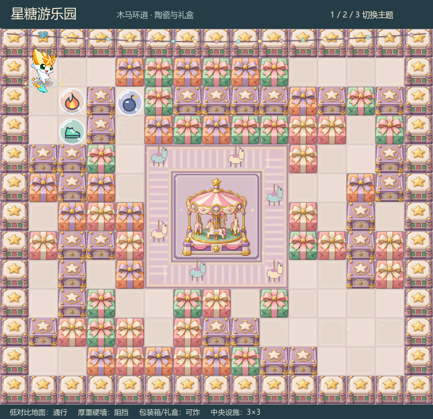

# 游乐园中央旋转木马

原先的静态木马亭已替换为已导出的 MiniMax H3 动画。使用 `assets/maps/animations/carousel-h3-sheet.png`：32 帧、每格 256×256、8 列×4 行，12.8fps，2.5 秒循环。原图集取图矩形和透明帧锚点固定，继续放在原来的中央 3×3 基座内。

`CarouselArt.gd` 按游戏时间取帧，由 `Board` 动态层绘制。暂停时保持同一帧，回放跳转按绝对游戏时间定位；时间变化不重画地板、硬墙、软砖或基座缓存。`MapSkin` 只缓存游乐园基座，中央静态亭图不再叠在透明动画下方。森林与工厂的设施保持原实现，原有外侧木马环道、炸弹运输与碰撞机制沿用既有逻辑。

退出对局清空 world 时，同时清理 MapPainter 保留的砖块绘图节点，避免上一张地图的缓存残留。

验证：实际 GPU 渲染 18 项、缓存 37 项、美术 60 项、玩法 35 项、传送带 40 项、保留砖块逐像素渲染 18 项，共 208 项通过。GPU 检查包含动画帧变化、首尾循环、暂停、回放定位、透明轮廓不超出碰撞区、屋顶/底座像素稳定、缓存不变及清空场景无残影。Windows / Web 均已重新导出，根目录 `启动游戏.bat` 使用更新后的 Windows 构建。

原 H3 帧及动画自身的形变限制见 `E:/MinimaxH3/deliverables/carousel_h3/README.md`。游戏图集与该交付图集 SHA-256 一致，没有另做动画姿势。安装备份、验证记录、32 帧真实引擎渲染与 MP4 位于 `E:/MinimaxH3/setup_records/carousel_integration/`。
